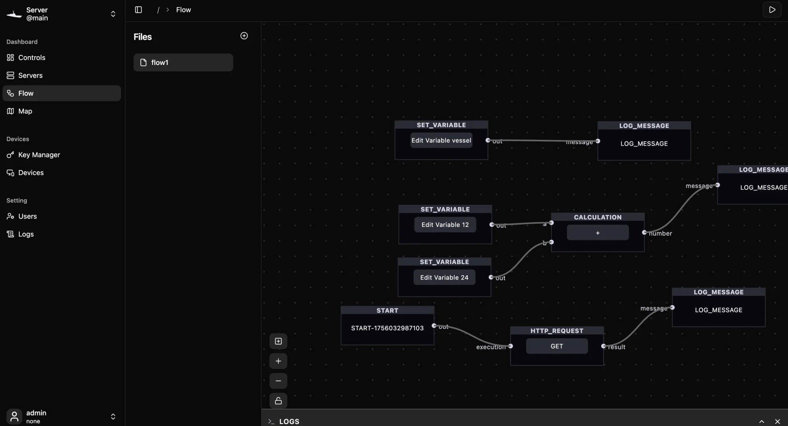

# Core concepts

Vessel has a small set of building blocks. Devices own entities, entities hold states, flows react to those states and act on the world, and dashboards and the map show you what is happening. This page explains each one and how data moves between your devices, the server and your browser.

## The big picture

Vessel has three parts:

- **Devices** in the field, such as a Raspberry Pi with a microphone, an IP camera or a GPS tracker. They send data to the server.
- **The server**, a single Rust program. It stores everything in SQLite, receives device data, runs your flows, and serves the web interface.
- **The client**, the web interface you open in a browser or in the desktop app. You use it to register devices, build flows and watch dashboards.

One client can switch between several servers. The account switcher at the top of the sidebar lists the servers you have signed in to.

## Devices

A device is one physical thing you connect. It is a container for entities and has no data of its own.

| Field | Meaning |
| --- | --- |
| **Device ID** | A unique text ID, for example `porch-pi`. Devices use it to identify themselves |
| **Name** | A readable name shown in the interface |
| **Manufacturer**, **Model** | Optional details |

A device can also have an access token. Open it with the **Key** action on the device. Devices that push data over HTTP send this token with every request. [More about devices](devices-and-entities).

## Entities and states

An entity is one value or stream that a device provides: a temperature reading, a GPS position, a camera feed. Every entity belongs to one device.

| Field | Meaning |
| --- | --- |
| **Entity ID** | A unique text ID, for example `porch-pi-temperature` |
| **Friendly Name** | The name shown on cards and on the map |
| **Platform (Protocol)** | How the data arrives: **MQTT**, **RTP over UDP**, **RTSP** or **HTTP** |
| **Type** | What the data is: **NONE**, **AUDIO**, **GPS**, **TEXT** or **VIDEO**. Cards and the map use it to decide how to show the entity |
| **Configuration (JSON)** | Protocol settings. Most often `state_topic`, the MQTT topic or HTTP path the value arrives on. RTSP entities use `rtsp_url` |

The **state** of an entity is its latest value, stored as text, together with the time it was last updated. Vessel keeps earlier states as history, which you can open from an entity card on the dashboard.

When you connect an integration such as Home Assistant or ROS 2, Vessel adds a device and an entity for that connection.

## Flows and nodes

A flow is an automation you draw in the [flow editor](flow). It is a graph of nodes connected by edges.

- A **node** does one job: fire on a timer, receive an MQTT message, compare two values, call a URL, publish a message, show a toast, or run object detection.
- **Ports** are the inputs on the left of a node and the outputs on the right. An edge carries a value from an output to an input.
- **Trigger nodes**, such as **Interval**, **Mqtt Subscribe** and **Dashboard Event Listener**, keep listening while the flow runs and start a new pass each time they fire. Nodes without inputs, such as **Start**, run once when the flow starts. Every other node runs when its inputs have values.
- **Custom nodes** are your own nodes, written as scripts. See [Custom nodes](custom-nodes).



### Flows run on the server

When you press the play button, the client saves the flow and asks the server to start it. The server's flow engine runs it from then on, so a running flow does not depend on your browser being open. Logs and toasts from running flows are sent back to the client over the WebSocket. [Every built-in node](flow-nodes).

## Dashboards

The **Controls** item in the sidebar opens the dashboards.

- The main **Dashboard** view shows server statistics (devices, entities, CPU and memory) and a card for every entity with its live state.
- **Home Assistant**, **ROS2** and **RTL-SDR** views appear when those integrations are connected.
- You can also create your own dashboards and arrange panels such as buttons, flow controls and maps on them.

[More about dashboards](dashboard).

## Map

The **Map** page puts your entities and your own drawings on a map. You organize drawings into layers of features, import GeoJSON and KML files, and click a GPS entity to see its state and details. [More about the map](map).

## Streams and recordings

Audio and video entities are streams rather than single values. The server receives RTP over UDP from devices, pulls RTSP from cameras, and passes the media on to your browser over WebRTC or as HLS over HTTP. The **Recordings** page lists streams you have recorded. [More about streams and recordings](streams-and-recordings).

## Integrations

Integrations connect Vessel to other systems. You manage them under **Settings ▸ Integration**.

| Integration | What it adds |
| --- | --- |
| Home Assistant | Your Home Assistant states in a **Home Assistant** dashboard view |
| ROS2 | A **ROS2** node group in the flow editor and a **ROS2** dashboard view |
| RTL-SDR | Tuning and live audio from an SDR receiver in an **RTL-SDR** dashboard view |

MQTT is not an integration but the main way devices send data. See [MQTT](mqtt) and [Integrations](integrations).

## Users and roles

Each person signs in with their own account. Accounts are managed under **Settings ▸ Users**. A role is a named set of permissions, such as `devices:read` or `flows:update`, and you assign roles to users. The server creates one account, `admin`, on first start. [More about users and roles](users-and-roles).

## How data moves

Devices talk to the server, and the server talks to the client. Each path uses the protocol that suits it.

### From devices to the server

| Protocol | How it works | Off by default? |
| --- | --- | --- |
| MQTT | Devices publish to your MQTT broker. Vessel connects to the broker, subscribes to every topic, and sets the state of the entity whose `state_topic` matches | Yes. Enable `mqtt_broker_url` |
| HTTP | Devices send `POST /api/states/<topic>` with `{"state": "..."}`, their access token, and an `X-Device-Id` header | No |
| RTP over UDP | Devices push audio or video to the RTP receiver, port `5004` by default | Yes. Enable `rtp_broker_port` |
| RTSP | The server pulls video from the camera URL in the entity's `rtsp_url` | No |

You turn the MQTT and RTP settings on under **Settings ▸ Config** and restart the server. See [Server configuration](configuration).

### From the server to the client

| Channel | Used for |
| --- | --- |
| HTTP (`/api`) | Signing in and reading or changing devices, entities, flows, dashboards, map layers, users and settings |
| WebSocket (`/signal`) | Live state changes, starting and stopping flows, flow logs and toasts, and WebRTC signaling |
| WebRTC | Live audio and video in the browser |
| HLS over HTTP | Live video as an alternative to WebRTC. Choose the default under **Settings ▸ Services** |

All of these share one port, `6174` by default, except WebRTC media.

### From flows to the world

Flows act through their nodes. **Mqtt Publish** sends a message to the broker, which also updates any entity listening on that topic. **Http Request** calls another HTTP service and **Websocket Send** sends to a WebSocket server. **Show Toast** pops up a message in the browser. This is how a flow closes the loop from sensor to response.

## Next steps

```cards
Quick start | quick-start | Put these concepts together in a first automation.
Devices and entities | devices-and-entities | Register hardware and describe its data.
The flow editor | flow | Build automations by connecting nodes.
```
