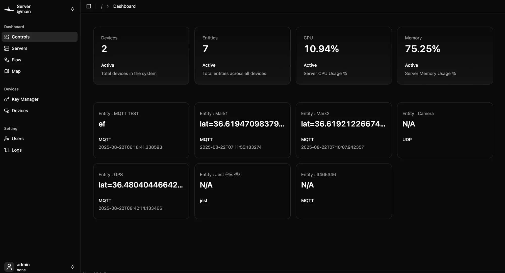

# Dashboards

Dashboards are the screens operators watch and act from. Vessel has one fixed main dashboard that shows every entity, plus any number of dynamic dashboards that you lay out yourself with entity cards, buttons, maps and flow controls.



## Open the dashboards

Click **Controls** in the sidebar, under **Dashboard**. Hover over **Controls** to open a small menu that lists every dashboard by name, so you can jump straight to one.

All dashboards sit side by side in one horizontal strip. Swipe left and right on a touch screen or trackpad, or scroll sideways, to move between them. The strip is always in this order:

| Position | Dashboard |
| --- | --- |
| First | **Dashboard**, the main dashboard |
| Next | **Home Assistant**, **ROS2** and **RTL-SDR**, but only while that integration is connected |
| Next | Your dynamic dashboards, in the order they were created |
| Last | **New canvas**, an empty panel for creating another dynamic dashboard |

The selector at the top left of the header shows where you are and lets you pick another dashboard from a list.

> [!NOTE]
> The integration dashboards are covered in [Integrations](integrations). This page covers the main dashboard and dynamic dashboards.

## The main dashboard

The main dashboard needs no setup. It always shows:

- Four summary cards: **Devices**, **Entities**, **CPU** and **Memory**.
- One card for every entity on the server, in a grid below them.

Entity values update live while the page is open.

### Entity cards

The card an entity gets depends on its platform and type. See [Devices and entities](devices-and-entities#entities) for what those are.

| Entity | What the card shows |
| --- | --- |
| **RTP over UDP** with type **VIDEO** | A **Play Video** button, the stream's **Online** or **Offline** status, and a **⋮** menu |
| **RTP over UDP** with type **AUDIO** | A **Play Audio** button with a level meter, **Online** or **Offline**, and a **⋮** menu |
| **RTSP** with type **VIDEO** | A **Play Video** button, **Online** or **Offline**, and a **⋮** menu |
| RTL-SDR | An **Open Panel** button that opens the RTL-SDR dashboard |
| Anything else | The latest state value, the platform, and when the state last changed |

The **⋮** menu on a stream card has **Start Recording** (or **Stop Recording** while one is running) and, for video, **Analyze Frame**. See [Streams and recordings](streams-and-recordings).

On a plain value card, click the value to open its state history: the first and last update, the number of changes, a timeline, and a list of every recorded value.

## Dynamic dashboards

A dynamic dashboard is a grid you fill yourself. Each one is saved on the server, so everyone who signs in to the same Vessel server sees the same layout.

### Create a dashboard

1. On the main dashboard, click **+** next to the dashboard selector. You can also swipe to the last panel, **New canvas**.
2. Click **Create dynamic dashboard**.

The new dashboard opens, empty, with a name like *Dynamic Dashboard 1*.

### Rename or delete a dashboard

Open the dashboard and click **⋮** next to its name in the header.

- **Rename** opens a dialog. Type a new name and click **Save**.
- **Delete** asks you to confirm. Deleting removes the layout for everyone and cannot be undone. The devices, entities, map layers and flows it showed are not affected.

## Build a layout

The canvas is a grid of 16 columns and 12 rows that fills the window. Items snap to the grid and never overlap.

### Add an item

Click **Add Item** at the top right of the canvas and choose:

| Menu item | Adds |
| --- | --- |
| **Add Entity** ▸ an entity | That entity's card, the same one the main dashboard shows |
| **Add Button** | A button that can trigger a running flow |
| **Add Map** ▸ a layer | A map panel showing one map layer |
| **Add Flow** ▸ a flow | A panel that shows a flow's status and starts or stops it |

**Add Map** is unavailable until at least one [map layer](map#layers) exists, and **Add Flow** until at least one [flow](flow) exists.

Vessel places the new item in the first free space, starting from the top left. Each item type has a default size, which is also the smallest it can be:

| Item | Default and minimum size (columns × rows) |
| --- | --- |
| Entity | 4 × 3 |
| Button | 2 × 2 |
| Map | 8 × 6 |
| Flow | 6 × 4 |

### Move, resize and remove items

| To | Do this |
| --- | --- |
| Move an item | Hover near the top edge of the item until a small white handle appears, then drag the handle |
| Resize an item | Drag any edge or corner of the item |
| Remove an item | Drag the item by its handle toward the top of the screen. A round **✕** target appears under the header. Drop the item on it |
| Edit a button | Double-click the button's handle |

An item will not move into a spot taken by another item, and it stops at the edges of the grid.

Every change is saved automatically about half a second after you make it. There is no save button.

> [!WARNING]
> Removing an item has no confirmation and no undo. Dropping an item on the **✕** deletes it right away.

## Item types

### Entity

Shows the same card as on the main dashboard, so a video entity can be played and recorded from here. If the entity is later deleted, the item shows *Entity not found*.

### Button

A large button with a label, *Action* by default. Clicking it sends an event to the server, which passes it to any running flow that is listening for it. See [Trigger a flow from a button](#trigger-a-flow-from-a-button).

To set it up, double-click the button's handle. The **Edit Button** dialog has two fields:

- **Label**: the text on the button.
- **Listener ID**: the name a flow listens for, such as `lights-toggle`. Letters, numbers, `_` and `-` only, up to 128 characters.

Click **Save**. If you click a button that has no listener ID, Vessel shows *Configure the button* instead of sending anything.

### Map

Shows one map layer on a dark base map, with its features drawn in their colors. Pick a different layer from the selector at the top of the panel. A badge shows how many features the layer has. You can pan and zoom inside the panel, but drawing and editing happen on the [Map](map) page.

### Flow

Shows one flow with a **Running** or **Stopped** badge and two buttons:

- **Run** starts the flow.
- **Stop** stops it.

Pick a different flow from the selector at the top of the panel. See [The flow editor](flow) for building flows.

## Trigger a flow from a button

A dashboard button does nothing on its own. It sends a named event, and a flow decides what happens.

1. In the [flow editor](flow), add a `DASHBOARD_EVENT_LISTENER` node (it is drawn as **Dashboard** on the canvas) and set its `listenerId`, for example `lights-toggle`.
2. Connect its **payload** output to the nodes that should run, and save the flow.
3. Start the flow, from the flow editor or from a flow panel on the dashboard.
4. On the dynamic dashboard, give a button the same **Listener ID**.
5. Click the button.

The listener node outputs the event as its payload:

```json
{
  "listener_id": "lights-toggle",
  "event_id": "4f0c…",
  "occurred_at": "2026-10-28T09:15:02.118Z",
  "dashboard_id": "…",
  "group_id": "…",
  "item_id": "…",
  "component_type": "button",
  "action": "click",
  "value": null,
  "source_session_id": "…"
}
```

> [!IMPORTANT]
> Only flows that are **running** receive button events. If nothing happens, check that the flow is started and that the listener ID matches exactly.

Rapid clicks are throttled. Repeat clicks on the same button within about a third of a second are dropped, both in the browser and on the server.

## On a phone

On narrow screens (under 768 pixels wide), a dynamic dashboard shows its items in a single column, in the order they were added, instead of on the grid. Items keep their relative heights. **Add Item** still works, but moving and resizing are only available on a wider screen.

Swiping sideways moves between dashboards just as on a desktop.

## Related pages

```cards
Map | map | Draw the layers that map panels display.
The flow editor | flow | Build the flows that buttons and flow panels control.
Devices and entities | devices-and-entities | Create the entities that cards display.
Streams and recordings | streams-and-recordings | Play and record the video on stream cards.
```
