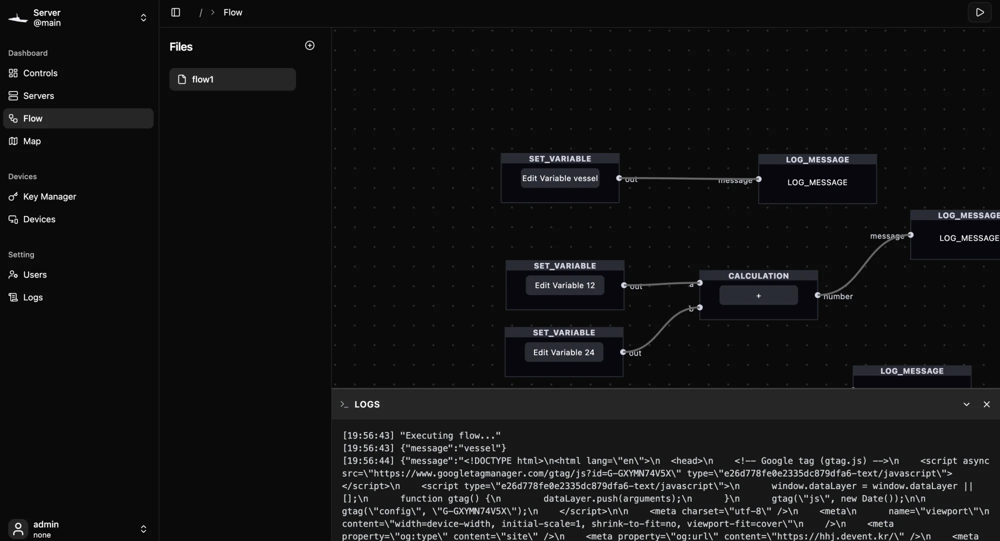

# The flow editor

A flow is a small program you draw instead of write. You place nodes on a canvas, connect an output of one node to an input of another, and press Run. The Vessel server then executes the graph in the background. It keeps running after you close the browser.

Open the editor from the sidebar with **Flow**.


## The editor at a glance

| Area | What it does |
| --- | --- |
| **Flows** list (left) | Every saved flow on this server. Click one to open it. **+** creates a new flow. |
| Canvas (center) | The graph of the open flow. Drag empty space to pan, scroll to zoom. |
| Toolbar (right edge of the canvas) | Add a node, zoom in, zoom out, lock the canvas, and open the custom node registry. |
| Run button (top right) | A play button starts the flow on the server. While it runs, it becomes a red stop button. |
| **LOGS** panel (bottom) | Messages from running flows. It opens on its own when messages arrive. |

## Create or open a flow

1. Click **+** next to **Flows**.
2. In **Create New Flow**, type a **Name** and click **Create**.
3. The new flow opens with an empty canvas.

To open another flow, click its name in the list. To delete one, hover over it, open the **⋯** menu, choose **Delete** and confirm with **Continue**. Deleting cannot be undone.

> [!NOTE]
> If the current flow has unsaved changes, Vessel asks before switching flows or leaving the page. Choose **Stay on this flow** to keep editing, or **Switch anyway** to discard the changes.

## Add nodes

1. Click the add button (the square with a plus) at the top of the canvas toolbar.
2. Point at a group: **Default**, **Data**, **Logic**, **Communication** or **AI/ML**. Two more groups appear when they apply: **ROS2** when the ROS 2 integration is connected, and **Custom Node** once you have registered custom nodes.
3. Click a node. It is placed in the middle of the current view.

Drag a node by its body to move it. Every node shows its type in its header, for example `MQTT_PUBLISH`. See the [node reference](flow-nodes) for what each one does.

## Connect nodes

Inputs sit on the left edge of a node and outputs on the right. Each port is labeled with its name.

1. Press on an output port and drag.
2. Release over an input port on another node. The line snaps to a port when you get close.

An edge always runs from an output to an input. Dragging from an input does nothing, and drawing the same connection twice is ignored. One output can feed many inputs.

> [!WARNING]
> Connect only one edge to each input port. A node waits until it has received as many values as it has incoming edges, and two edges into the same port count twice but fill only one slot, so the node never runs.

## Select and delete

- Click a node or an edge to select it. The selection turns blue.
- Press <kbd>Backspace</kbd> to delete the selection. Deleting a node also removes its edges.
- With a node selected, the trash button in the top-left corner of the canvas deletes it too.
- Click empty canvas to clear the selection.

## Configure a node

Most nodes have options, such as an MQTT topic or a URL. Click the button in the middle of the node to open them. Depending on the node it reads **Change Attr**, **Edit Variable**, or the current value, such as `GET` on an HTTP Request node or the topic on an MQTT node.

1. Click the button in the middle of the node.
2. The **Edit** panel slides in. Each option is listed under its internal name, such as `topic` or `variableType`.
3. Change the values and click **Save Changes**.

Nodes without options, such as **Start**, **Branch** or **Log Message**, have no button in the middle. Fields that are grayed out in the **Edit** panel are fixed by the node and cannot be changed.

## Save and run

There is no separate save button. **Pressing Run saves the graph and then starts it.** Each save is stored as a new version of the flow, and the server always runs the latest saved version.

1. Click the play button in the top-right corner.
2. The graph is saved and sent to the server, which starts executing it.
3. The button turns into a red stop button.
4. Click the stop button to stop the flow. This also saves the graph.

A few things to know about running flows:

- A flow runs on the server, not in your browser. Closing the tab does not stop it.
- Each flow can have only one run at a time.
- Flows do not start by themselves when the server starts. After a server restart, press Run again.
- Changing a running flow does not affect the run. Stop it and run it again to apply your edits.

## The LOGS panel



The **LOGS** panel opens at the bottom of the canvas when the server sends messages. It shows:

- `"Executing flow..."` when a flow starts.
- Whatever reaches a **Log Message** node, as JSON.
- A short line from some nodes, such as `"Publish MQTT Topic"` from **Mqtt Publish**.
- Errors from some nodes, for example a value that could not be parsed.

Click the header to collapse or expand the panel. The **×** button closes it and clears the lines. Logs from every running flow on the server appear here, not only from the flow on screen.

> [!TIP]
> Not every error reaches the **LOGS** panel. If a node seems to do nothing, check the server log under **Settings** ▸ **Log**.

## How data moves along edges

Every value that travels along an edge is a JSON value: a string, number, boolean, `null`, object or array. Ports are not typed in the editor, so you can connect anything to anything. A mismatch shows up when the flow runs, for example when **Calculation** receives text instead of a number. Use **Type Converter** to change a value's type on the way.

The server runs a flow like this:

1. When the flow starts, every node with no incoming edges runs once. Trigger nodes are the exception.
2. Trigger nodes, such as **Interval**, **Mqtt Subscribe** or **Websocket On**, wait for their event and run each time it happens.
3. When a node finishes, its outputs are passed along its edges.
4. A node runs as soon as all of its connected inputs have a value. Inputs with no edge are ignored.
5. Nodes run one at a time, in the order they become ready.

Some nodes only produce one of their outputs. **Branch**, for example, sends its data either to `true_output` or to `false_output`. Nodes connected to the other output do not run for that value.

> [!NOTE]
> When **Mqtt Subscribe** or **Rtp Stream In** receives a message, the server also re-runs the flow's other starting nodes (the nodes with no incoming edges). This makes a constant from **Set Variable** available again for every message.

Many nodes accept an `exec` or `execution` input. It only decides *when* the node runs; the value itself is not used. Connect any output to it, such as the `out` port of **Start** or the `exec` port of **Interval**.

## Keyboard shortcuts

| Keys | Action |
| --- | --- |
| <kbd>Backspace</kbd> | Delete the selected node or edge |
| <kbd>⌘</kbd> <kbd>K</kbd> or <kbd>Ctrl</kbd> <kbd>K</kbd> | Open or close the [AI assistant](ai-assistant), which can build and edit flows for you |

## Next steps

```cards
Node reference | flow-nodes | Every built-in node, its ports and its options.
Custom nodes | custom-nodes | Write your own node as a small script.
AI assistant | ai-assistant | Describe a flow in plain language and let the assistant draw it.
Dashboards | dashboard | Trigger flows from buttons and other dashboard widgets.
```
