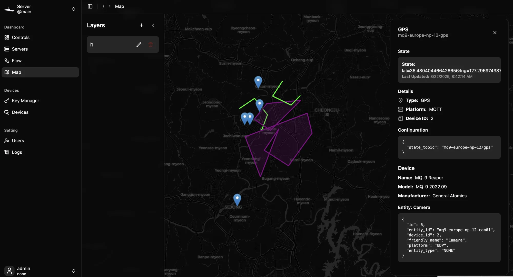

# Map

The Map page is Vessel's geographic view. You draw points, lines and areas on named layers, and GPS entities appear on top as markers you can click for details.



Open it with **Map** in the sidebar.

## Parts of the map page

| Part | Where | What it does |
| --- | --- | --- |
| **Layers** list | Left | Lists your layers. Click one to show it and make it the layer you draw on |
| Toolbar | Top right | Drawing tools, base map buttons, and finish or cancel while drawing |
| Zoom buttons | Bottom right | **+** and **−** |
| Scale bar | Bottom right | The distance that 100 pixels covers at the current zoom |
| Details panel | Right, when open | Shows the feature or entity you clicked |
| Your location | On the map | A green circle at the browser's current position, if you allow location access |

You can also zoom with the scroll wheel or a pinch, and pan by dragging.

## Layers

A layer is a named collection of features. The map shows one layer at a time: the one selected in the **Layers** list. Every drawing tool works on that layer, so the tools stay disabled until you select one.

### Create a layer

1. In the **Layers** list, click **+**.
2. Enter a **Name** and, if you like, a **Description**.
3. Click **Save changes**.

Click the new layer in the list to select it.

### Edit or delete a layer

Click **⋯** next to a layer's name:

- **Edit layer** changes its name and description.
- **Export as GeoJSON** and **Export as KML** download the layer as a file.
- **Delete layer** removes the layer and all its features, after you confirm. This cannot be undone.

### Import a layer

Click the upload button at the top of the **Layers** list and choose a `.geojson`, `.json` or `.kml` file. Vessel creates a new layer named after the file, without its extension.

### Hide the layer list

Click **‹** at the top of the list to collapse it and see more of the map. To bring it back, click the **⋯** button at the top left of the map and choose **Expand sidebar**.

## Drawing

Select a layer first. Then use the three tools at the top of the toolbar:

| Tool | Icon | Draws |
| --- | --- | --- |
| Point | Map pin | A single location |
| Line | Signpost | A path through two or more points |
| Polygon | Rounded square | A closed area |

### Draw a point

1. Click the Point tool.
2. Click the map where the point should go.

The point is saved as soon as you click, and the tool turns off.

### Draw a line or polygon

1. Click the Line or Polygon tool.
2. Click the map to place each vertex in order. A preview follows your clicks.
3. Click **✓** in the toolbar to save the shape. You need at least two vertices.

To abandon a shape, click **✕** in the toolbar or press <kbd>Esc</kbd>.

## Editing a feature

Click any feature on the map to select it. The details panel opens on the right:

| Section | Shows |
| --- | --- |
| Title | The feature's type icon and *Feature* followed by the first eight characters of its ID |
| **Geometry** | **Location** for a point, **Length** for a line, **Area** for a polygon |
| **Style** | The feature's **Color** |
| **Vertices** | The latitude and longitude of every vertex, to six decimal places |

What you can do from there:

- **Move a vertex.** While a feature is selected, each of its vertices shows a round handle on the map. Drag a handle to a new spot. The change is saved when you let go.
- **Change the color.** Click **Modify**, pick a color, then click **Save**. **Cancel** discards the change.
- **Delete the feature.** Click **Delete** and confirm. This cannot be undone.

Use **−** in the panel header to collapse the panel, and **✕** to close it and deselect the feature.

## Base maps

The two buttons below the drawing tools switch the background:

- The map icon shows a dark street map from CARTO, based on OpenStreetMap. This is the default.
- The satellite icon shows aerial imagery from Esri.

Your choice is remembered in this browser.

> [!NOTE]
> Base map tiles are downloaded from those providers, so the background needs an internet connection. Your layers, features and entities are stored on your Vessel server and still draw without one.

## Entities on the map

Every entity whose type is **GPS** and whose current state contains a position appears as a white map pin. Vessel reads the position from the state text: it looks for `lat=` and `lng=` followed by a number.

```text
lat=37.5665,lng=126.9780
```

Anything else in the state is ignored, so `lat=37.5665 lng=126.9780 alt=40` works too. A state without both values puts no marker on the map. See [GPS entities](devices-and-entities#gps-entities) for how to create one and send it positions.

Click a marker to open the entity's panel:

| Section | Shows |
| --- | --- |
| **State** | The raw state and when it was last updated |
| **Details** | The entity's **Type**, **Platform** and **Device ID** |
| **Configuration** | The entity's configuration JSON, if it has one |
| **Device** | The **Name**, **Model** and **Manufacturer** of the device it belongs to |
| Entity cards | A card for every entity of that device, so you can play a camera mounted on a vehicle right from its marker |

> [!NOTE]
> Marker positions are read when the Map page opens. To see a newer position, open the page again or reload it.

## Where the map opens

The map remembers where you left it. Every time you pan or zoom, the center and zoom level are saved in this browser, and the next visit opens at the same spot.

On a first visit, the map centers on your location if the browser shares it within two seconds. Otherwise it opens over the center of the United States.

## Maps on dashboards

Any layer can be shown on a dynamic dashboard with **Add Item ▸ Add Map**. The dashboard panel shows the layer's features on the dark base map and lets you switch layers, but it does not show entity markers and cannot draw or edit. See [Dashboards](dashboard#map).

## Where map data is stored

Each layer is saved on the server as a GeoJSON file in the `storage/maps` folder inside the server's working directory, one file per layer. To back up your map data, copy that folder.

## Related pages

```cards
Dashboards | dashboard | Put map layers on a dynamic dashboard.
Devices and entities | devices-and-entities | Create GPS entities that appear as markers.
Core concepts | concepts | How devices, entities and layers fit together.
```
